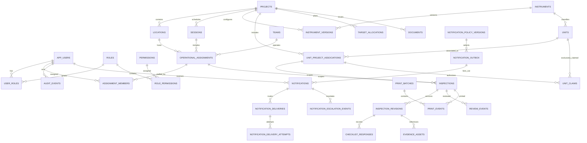

# Data Model and ERD — Dit. SD Inspection

Status: Logical data model draft — not a migration specification  
Version: 0.3.0

## Physical schema and RLS reconciliation status

The logical ERD is reconciled against the physical schema and RLS catalogue in [Physical Schema ↔ RLS ↔ Command Reconciliation](PHYSICAL-SCHEMA-RLS-COMMAND-RECONCILIATION.md). The documentation design now proposes 48 physical/RLS tables: the original 41 plus `print_batches` and six notification lifecycle tables. `notification_events` is removed as an ambiguous placeholder and replaced by explicit outbox, inbox, delivery, attempt, policy-version and escalation entities. This is a documentation proposal only; no live schema, deployed RLS or grants are verified.

## 1. Modeling rules

- PostgreSQL is the sole source of truth.
- Use UUID primary keys for application entities.
- Store timestamps as `timestamptz` in UTC; render local time at the presentation boundary.
- Store monetary/quantitative values using exact numeric types where applicable; do not use floating point for counts or measurements requiring exactness.
- Use foreign keys, unique constraints, check constraints, and transactions for integrity.
- Avoid hard deletes for operational history. Use lifecycle status and append-only events.
- Submitted inspection revisions and evidence originals are immutable.
- Every tenant-like boundary is a project/location/session scope; do not create SaaS tenant abstractions without approved scope.

## 2. Logical ERD

## 3. Proposed entity groups

### Identity and authorization
- `auth.users`: Supabase-managed identity; do not duplicate passwords.
- `app_users`: application profile, approval status, display identity, activation state.
- `roles`, `permissions`, `role_permissions`, `user_roles`: configurable RBAC catalog and grants.
- `user_scope_grants`: explicit project/location/session/assignment scope, effective dates, grantor, reason.
- `account_decisions`: approval/rejection history.

### Planning and assignments
- `projects`, `locations`, `sessions`, `teams`.
- `operational_assignments`: exactly one project, session, location, instrument, and team per assignment.
- `assignment_members`: user, assignment, operational role, effective interval, status.
- `project_capacity_settings`: configured Inspector cap; enforce range 1..100 with default 50 and global combined count transactionally.
- `target_plans`, `target_allocations`: immutable/versioned target schedules and assignment of reporting quantities to dates.

### Instruments and inspection
- `instruments`: extensible instrument catalog; instrument definitions are not hardcoded to IFP/Standing Bracket. Super Admin manages catalog lifecycle through authorized commands.
- `instrument_versions`, `checklist_sections`, `checklist_items`, `specification_fields`, `evidence_slot_definitions`: declarative, versioned configuration primitives for supported checklist, specification, and evidence requirements.
- Published versions are immutable; active sessions bind to one explicit version, and inspection revisions retain that exact snapshot. Adding a new instrument within supported primitives must not require an application code change. Arbitrary executable configuration is prohibited.
- `units`: canonical physical identity, independent of project, with instrument-type-scoped normalized serial key.
- `unit_project_associations`: durable, project-scoped association episodes connecting a canonical unit to a project without cloning the unit identity; ended associations remain for history.
- `unit_identity_conflicts`: controlled duplicate-serial review records; no silent merge or duplicate canonical row.
- `inspections`: stable aggregate identity and current lifecycle state, bound to the exact `unit_project_association_id` and the same project's operational assignment.
- `inspection_revisions`: immutable submitted snapshots, revision number, author, submitted timestamp, instrument version.
- `checklist_responses`: response per revision/item, answer, exception reason, optional note.
- `unit_claims`: claim holder, assignment, expiry, release reason/status, version token.
- `review_events`: append-only return/approve/reopen decisions.

### Evidence and documents
- `evidence_assets`: private object key, checksum, size, MIME type, slot/item, uploader, upload state, capture metadata.
- `documents`: generated PDF/BA/attendance document metadata, template version, source revision, checksum.
- `print_batches`: durable batch identity, initiating actor, scope, requested count, idempotency hash, aggregate lifecycle/status and optional retry lineage; not proof of physical printer output.
- `print_events`: append-only per-document attempt with actor, time, exact document version, atomic per-document sequence, outcome (`SUCCESS_RECORDED`, `FAILED`, `CANCELLED`), optional batch reference, safe result/error code and idempotency reference. Failed-only retry appends a new attempt and never overwrites history.
- `attendance_records`, `attendance_documents`: generated roster and uploaded signed evidence lifecycle.

### Audit and operations
- `audit_events`: append-only actor/action/target/scope/time/correlation metadata.
- `idempotency_records`: command key, actor, request hash, result reference, expiry/retention.
- `sync_batches`: client batch identity, acknowledgement, conflict references.
- `notification_policy_versions`: immutable, validated, scope-bound notification policy snapshots.
- `notification_outbox`: transactional source-event fan-out intents, pinned to a policy version.
- `notifications`: recipient-specific in-app inbox records with independent read/dismiss timestamps.
- `notification_deliveries`: current per-channel delivery projection, separate from inbox read state.
- `notification_delivery_attempts`: append-only sanitized provider attempt history.
- `notification_escalation_events`: append-only SLA/reminder/escalation decisions.

## 4. Key integrity constraints

1. One canonical normalized serial identity per instrument type across all projects (T-16 PO-approved option B); different instrument types may reuse the same serial. Project ID is not part of the uniqueness key.
2. Project membership is represented by durable `unit_project_associations`; inspections and claims must reference the exact association and same-project assignment. A canonical unit ID alone grants no access.
3. One active claim per canonical unit globally, preventing concurrent claims through two different project associations; claim acquisition and expiry takeover are atomic.
4. Inspector capacity counts distinct active users globally across both locations, not assignment rows. Range is 1..100, default 50.
5. A user cannot hold overlapping operational assignments at different locations; enforce by transaction/constraint strategy after schedule semantics are approved.
6. One operational assignment has one location, one instrument, and one team.
7. Revision numbers are unique per inspection; submitted revisions cannot be updated or deleted by application roles.
8. Checklist response references an item in the exact instrument version snapshot used by the revision.
9. Evidence metadata references a valid slot/item, exact immutable inspection revision and exact instrument version; preserve checksum, uploader, capture/upload timestamps and immutable object identity. Replacement creates a new evidence record and audit event; finalized objects are never overwritten in place.
10. Print batches persist a stable batch ID and requested count; each per-document attempt is appended to `print_events` with batch reference, immutable document version, outcome and concurrency-safe sequence. Batch status is derived/maintained from per-document outcomes; retry is failed-only and cannot duplicate a successful outcome.
11. Notification source-event fan-out is durable through `notification_outbox`; one inbox row per recipient is unique per outbox, one delivery projection per channel is unique per notification/channel, attempts and escalations are append-only, and read state is independent.
12. Target allocations are versioned and never mutate actual inspection timestamps.

## 5. State versus event

Use state columns for current query efficiency, backed by append-only domain events for meaningful transitions. The state update and event append must occur in the same database transaction. Do not use an event-sourcing platform; this is a relational application with audit history.

## 6. ERD limitations and open questions

This is a logical model, not a final physical schema. Resolve before migrations:
- institution-approved exception/normalization policy for the PO-approved instrument-type-wide serial uniqueness rule;
- project/session lifecycle and temporal assignment semantics;
- exact role/scope inheritance model;
- whether evidence is attached to checklist response, inspection, or both;
- claim expiry/reassignment edge cases during offline work;
- target quantity semantics and reconciliation;
- attendance/BA verification authority;
- retention, deletion, and privacy policy;
- which documents require immutable snapshots and signatures.

## 7. Migration discipline

- Every schema change is a reviewed migration in Git.
- Migrations are forward-only in production unless a tested rollback is safe; destructive changes require expand/migrate/contract.
- Add constraints only after existing data validation in the target environment.
- Test migration on a disposable database and verify restore/rollback path.

## T-14 — Inspector capacity counting semantics (PO-approved 2026-11-24)

Capacity counts distinct enabled login accounts with an active Inspector role grant and at least one currently effective operational Inspector assignment in the governed project/session scope. Multiple roles or assignments do not multiply the count. Pending, rejected, suspended, disabled and expired-role accounts are excluded. Enforce the combined cap atomically across both locations: minimum 1, default 50, maximum 100. Reject invalid cap values and reductions below the current qualifying count; never silently deactivate accounts. This predicate is the canonical interpretation for the data model.

## Registration-first and Super Admin-managed staffing (PO clarification, 2026-11-24)

Model account registration/approval separately from role grants, team memberships and operational assignments. A registered identity begins pending; registration alone grants no role, scope, team membership or Inspector capacity eligibility. Super Admin approves the account and controls role grants, permissions, scope, team count, team membership and operational assignments. Every team member and assignment must reference an existing approved/enabled account. Users cannot self-assign. T-14 capacity counts only distinct enabled accounts with an active Inspector grant and an effective operational assignment.

## T-16 — Canonical unit identity and evidence linkage (PO-approved option B, 2026-11-24)

`units` represent canonical physical identity within an instrument type, not a project-local duplicate. Enforce uniqueness on `(instrument_type, serial_normalized)` across every project. `instrument_type` is a stable immutable canonical key on the instrument catalogue; the catalog row ID is not part of physical identity. A project association must preserve project/session authorization and inspection history without cloning the canonical unit. Same-type duplicate discovery is a controlled conflict requiring authorized resolution, reason and audit; never silently merge or rewrite historical records. Different instrument types may reuse a serial string.

Each evidence asset is linked to the exact immutable inspection revision and instrument version, with original metadata, checksum, uploader, capture/upload timestamps and immutable storage object identity. No in-place overwrite or destructive replacement is allowed. A replacement creates a new evidence record and audit event. This remains design-level until schema, RLS, commands and tests are reconciled.

## Instrument publication governance — T-17 option A

Super Admin manages the extensible instrument catalog and may directly publish a version only through the trusted `publish-instrument-version` command after server-side validation of the bounded declarative schema. No second-person publication approval is required. The actor is derived from the authenticated server context and must hold explicit `instrument.publish`. Draft editing and publishing are distinct permissions. Publication and its audit record are atomic; a published version is immutable. Deactivation is a separate audited lifecycle command and does not delete or mutate historical versions. Sessions/assignments pin a published version; inspection revisions retain the exact version ID and canonical snapshot/hash. New versions do not silently rebind active sessions or historical records.

The canonical `units` identity may be referenced by multiple project associations, but canonical identity is not an authorization grant. Inspection/claim/evidence operations must resolve and enforce the explicit project association plus session, assignment and permission. The association cardinality/FK strategy is specified in the T-16 relational contract below; it remains subject to technical review and institution-approved serial policy. Do not infer a project-wide/global operational grant from `unit_id`.

## T-16 — Canonical unit and project-association relational contract (design reconciliation)

**Canonical identity:** `units` contains one physical identity per `(instrument_type, serial_normalized)` across all projects. It has no `project_id`. A non-null normalized serial is unique within its instrument type; different instrument types may reuse the same serial. Preserve raw serial and normalization-policy version. Null/unknown serials use distinct UUID identities and never a shared empty key.

**Project association:** `unit_project_associations` is a separate durable relation with at least `id`, `unit_id`, `project_id`, `status`, `associated_at`, `associated_by`, `association_reason`, `ended_at`, `ended_by`, and `end_reason`. A partial unique constraint permits at most one ACTIVE association for a given `(unit_id, project_id)` while retaining ended/revoked association episodes. A composite unique key `(id, unit_id, project_id)` supports referential proof. Associations are never hard-deleted; lifecycle changes are audited. The model permits one canonical unit to have associations in multiple projects without copying the unit record.

**Inspection binding:** each inspection stores `unit_id`, `unit_project_association_id`, `project_id`, and `assignment_id`. Composite foreign keys prove `(association_id, unit_id, project_id)` exists and `(assignment_id, project_id)` belongs to the same project. A command also verifies assignment instrument matches the canonical unit's instrument and that the association is ACTIVE at claim/inspection start. Historical inspections keep their exact association row even after it is ended. No inspection may be authorized from `unit_id` alone.

**Claim binding:** each claim stores the same association/project context and references an assignment in that project. A partial unique index on `unit_claims(unit_id) WHERE status='ACTIVE'` enforces one active claim for the physical unit across all projects; the claim command locks the canonical unit row before checking association, assignment, eligibility and existing claims. This avoids simultaneous cross-project claims for one physical unit. Expiry/release changes claim lifecycle; it does not delete drafts, evidence or association history.

**Duplicate conflict workflow:** registering a serial first normalizes it under the instrument's published normalization policy and attempts the canonical unique key. A collision opens `unit_identity_conflicts` with the submitted raw value, instrument, normalized key, proposed project, candidate canonical unit, reporter, status and resolution audit. It does not create a second `units` row or automatically attach the candidate. An authorized reviewer may verify the physical identity and create a project association to the existing canonical unit, or reject/close the conflict with reason. No destructive merge, reassignment of historical inspection rows, or silent overwrite is allowed. Institution-approved exception policy remains an external gate; until approved, no duplicate same-type canonical identity exception is allowed.

**RLS and command rule:** all reads and writes resolve through the association's project and the caller's effective session/assignment/permission. Super Admin catalog permissions and canonical unit visibility do not grant project membership. Association creation/ending and conflict resolution are privileged commands through the T-18 caller-JWT boundary with atomic audit.

This is the recommended relational resolution of T-16's approved uniqueness rule and existing project-scope requirements. It closes the ambiguity in the logical design; it is not a migration, runtime implementation, institutional exception approval or test result.

## CMD-011–020 Product Owner semantic alignment (2026-11-24)

The logical ERD must represent the PO-approved semantics recorded in the Decision Register: canonical T-07 session states (DRAFT/ACTIVE/PAUSED/CLOSED); closure request as an event/action rather than a persisted state; immutable session code; session-scoped target plans by default; per-membership effective end times; end-dated assignment history; normalized unique instrument code; complete draft configuration replacement; immutable published instrument versions and session/assignment version pinning.

This is a logical-model alignment note, not a physical schema approval. The ERD must not imply that row-version fields, canonical config hashes, timestamp precision, uniqueness/exclusion constraints, trigger behavior, RLS or lock ordering have been finalized. Those remain explicit technical design dependencies in the physical schema, concurrency reconciliation and command reviews.
