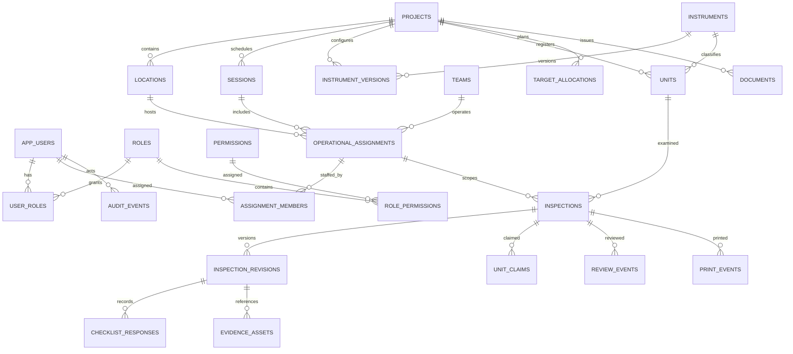

# Data Model and ERD — Dit. SD Inspection

Status: Logical data model draft — not a migration specification  
Version: 0.1.0

## 1. Modeling rules

- PostgreSQL is the sole source of truth.
- Use UUID primary keys for application entities.
- Store timestamps as `timestamptz` in UTC; render local time at the presentation boundary.
- Store monetary/quantitative values using exact numeric types where applicable; do not use floating point for counts or measurements requiring exactness.
- Use foreign keys, unique constraints, check constraints, and transactions for integrity.
- Avoid hard deletes for operational history. Use lifecycle status and append-only events.
- Submitted inspection revisions and evidence originals are immutable.
- Every tenant-like boundary is a project/location/session scope; do not create SaaS tenant abstractions without approved scope.

## 2. Logical ERD

## 3. Proposed entity groups

### Identity and authorization
- `auth.users`: Supabase-managed identity; do not duplicate passwords.
- `app_users`: application profile, approval status, display identity, activation state.
- `roles`, `permissions`, `role_permissions`, `user_roles`: configurable RBAC catalog and grants.
- `user_scope_grants`: explicit project/location/session/assignment scope, effective dates, grantor, reason.
- `account_decisions`: approval/rejection history.

### Planning and assignments
- `projects`, `locations`, `sessions`, `teams`.
- `operational_assignments`: exactly one project, session, location, instrument, and team per assignment.
- `assignment_members`: user, assignment, operational role, effective interval, status.
- `project_capacity_settings`: configured Inspector cap; enforce range 1..100 with default 50 and global combined count transactionally.
- `target_plans`, `target_allocations`: immutable/versioned target schedules and assignment of reporting quantities to dates.

### Instruments and inspection
- `instruments`: extensible instrument catalog; instrument definitions are not hardcoded to IFP/Standing Bracket. Super Admin manages catalog lifecycle through authorized commands.
- `instrument_versions`, `checklist_sections`, `checklist_items`, `specification_fields`, `evidence_slot_definitions`: declarative, versioned configuration primitives for supported checklist, specification, and evidence requirements.
- Published versions are immutable; active sessions bind to one explicit version, and inspection revisions retain that exact snapshot. Adding a new instrument within supported primitives must not require an application code change. Arbitrary executable configuration is prohibited.
- `units`: project/instrument scoped unit identity and normalized serial key.
- `inspections`: stable aggregate identity and current lifecycle state.
- `inspection_revisions`: immutable submitted snapshots, revision number, author, submitted timestamp, instrument version.
- `checklist_responses`: response per revision/item, answer, exception reason, optional note.
- `unit_claims`: claim holder, assignment, expiry, release reason/status, version token.
- `review_events`: append-only return/approve/reopen decisions.

### Evidence and documents
- `evidence_assets`: private object key, checksum, size, MIME type, slot/item, uploader, upload state, capture metadata.
- `documents`: generated PDF/BA/attendance document metadata, template version, source revision, checksum.
- `print_batches`: batch identity, initiating actor, timestamp, requested document count, and lifecycle/status metadata; batch is an orchestration record, not proof of all-document success.
- `print_events`: one append-only per-document event with actor, time, exact document version, atomic reprint ordinal, outcome (`SUCCESS_RECORDED`, `FAILED`, `CANCELLED`), batch reference when applicable, and safe client/application result metadata.
- `attendance_records`, `attendance_documents`: generated roster and uploaded signed evidence lifecycle.

### Audit and operations
- `audit_events`: append-only actor/action/target/scope/time/correlation metadata.
- `idempotency_records`: command key, actor, request hash, result reference, expiry/retention.
- `sync_batches`: client batch identity, acknowledgement, conflict references.
- `notification_events`: durable in-app notification state if approved.

## 4. Key integrity constraints

1. One active normalized serial claim per project + instrument (exact uniqueness scope to validate against official operational rules).
2. One active claim per unit; claim acquisition and expiry takeover are atomic.
3. Inspector capacity counts distinct active users globally across both locations, not assignment rows. Range is 1..100, default 50.
4. A user cannot hold overlapping operational assignments at different locations; enforce by transaction/constraint strategy after schedule semantics are approved.
5. One operational assignment has one location, one instrument, and one team.
6. Revision numbers are unique per inspection; submitted revisions cannot be updated or deleted by application roles.
7. Checklist response references an item in the exact instrument version snapshot used by the revision.
8. Evidence metadata references a valid slot/item and inspection revision; object key is immutable once finalized.
9. Print events are append-only; a reprint creates a new event. Each event references the exact immutable document version and has a concurrency-safe per-document sequence.
10. Batch print outcomes are per-document; retry can reference failed documents only and cannot duplicate a previously successful event.
10. Target allocations are versioned and never mutate actual inspection timestamps.

## 5. State versus event

Use state columns for current query efficiency, backed by append-only domain events for meaningful transitions. The state update and event append must occur in the same database transaction. Do not use an event-sourcing platform; this is a relational application with audit history.

## 6. ERD limitations and open questions

This is a logical model, not a final physical schema. Resolve before migrations:
- exact uniqueness scope and normalization rules for serial numbers;
- project/session lifecycle and temporal assignment semantics;
- exact role/scope inheritance model;
- whether evidence is attached to checklist response, inspection, or both;
- claim expiry/reassignment edge cases during offline work;
- target quantity semantics and reconciliation;
- attendance/BA verification authority;
- retention, deletion, and privacy policy;
- which documents require immutable snapshots and signatures.

## 7. Migration discipline

- Every schema change is a reviewed migration in Git.
- Migrations are forward-only in production unless a tested rollback is safe; destructive changes require expand/migrate/contract.
- Add constraints only after existing data validation in the target environment.
- Test migration on a disposable database and verify restore/rollback path.
