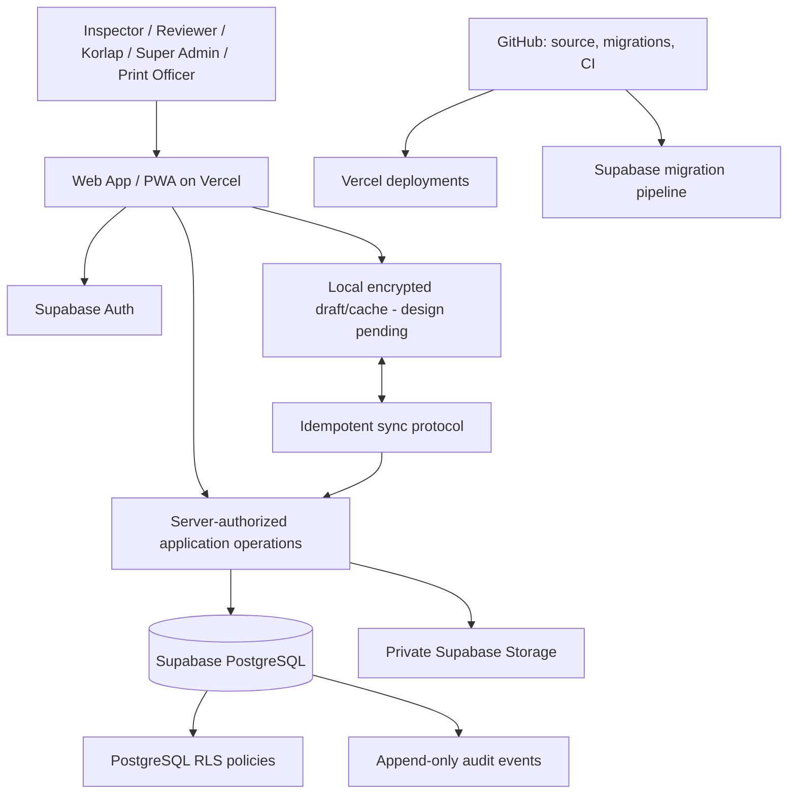

# System Architecture — Dit. SD Inspection

Status: Technical design draft — approval required  
Version: 0.1.0  
Decision baseline: ADR-001 (Supabase + Vercel)

## 1. Architectural goals

- Deliver a production-grade replacement for the known IFP and Standing Bracket inspection workflows.
- Keep the architecture simple and economical for a small engineering team.
- Support up to 100 Inspector accounts across both locations (configurable starting capacity 50, hard maximum 100).
- Design and verify application behavior for up to 100 authenticated users concurrently; this is a separate performance target.
- Preserve evidence, inspection revisions, authorization boundaries, and auditability.
- Support constrained mobile networks and a deliberately limited offline draft workflow.

## 2. Logical architecture

## 3. Deployment and trust boundaries

- Browser: untrusted client. It may hold the public Supabase URL and publishable/anon key only. It never receives service-role credentials.
- Vercel application/server boundary: trusted only for narrowly scoped server operations; validate identity, role, permission, assignment scope, payload, and idempotency on every command.
- Supabase Auth: identity provider. An authenticated Google identity is not automatically an approved application user.
- PostgreSQL: authoritative state and transaction boundary. RLS is mandatory for user-scoped access. Critical state changes are database transactions/functions or server-authorized transactional operations.
- Storage: private buckets only. Upload/download authorization must be tied to an authorized inspection and evidence slot.
- GitHub: source and change history; secrets are environment-scoped and least-privilege.

## 4. Application structure

Use a modular monolith, not microservices. Separate modules by business capability:
1. Identity and account approval.
2. Roles, permissions, and scoped assignments.
3. Project, session, location, team, and target planning.
4. Instrument catalog and immutable configuration versions.
5. Unit registry, claims, and inspection lifecycle.
6. Evidence and offline synchronization.
7. Review, correction, and approval.
8. PDF/document/print/BA/attendance.
9. Reporting and dashboards.
10. Audit, notifications, and operations.

Modules may share one PostgreSQL database but must not bypass domain authorization or transaction rules.

## 5. Data flow

- Reads are scoped by RLS and server authorization.
- Commands are validated and committed transactionally.
- Evidence bytes are stored as private objects; relational metadata and lifecycle are stored in PostgreSQL.
- Submitted inspection revisions reference immutable checklist/configuration snapshots.
- Reporting reads derive from actual event timestamps and separately versioned target allocations.
- Offline clients store only permitted draft state; server acknowledgement is the only signal that a command is durably synchronized.

## 6. Technology constraints

- Supabase PostgreSQL: only primary database.
- Supabase Auth: Google identity; application approval and RBAC remain application domain concerns.
- Supabase Storage: private evidence and generated artifacts as approved.
- Vercel: web/PWA hosting and narrowly scoped server-side operations.
- GitHub: source control, PR review, migrations, and cost-conscious CI.
- No Firebase, Redis, VPS, queue service, second database, or microservices without a new ADR backed by measured requirements.

## 7. Environment strategy

Preferred: isolated development, staging, and production environments where plan eligibility and cost allow. If a separate staging project is not affordable, use an explicitly approved lower-cost test environment and synthetic data; never use production personal/evidence data for routine testing. Production secrets and storage must not be reused by preview deployments.

## 8. Architecture decisions still open

- Exact frontend framework and package versions.
- **T-18 PO APPROVED option A (2026-11-24):** protected writes use individually reviewed narrow SECURITY DEFINER PostgreSQL command wrappers owned by a dedicated least-privileged NOLOGIN role; read-only/scoped paths use SECURITY INVOKER and RLS where feasible. Vercel routes forward the verified caller JWT; PostgreSQL derives the actor and enforces authorization/atomicity. Browser direct DML remains denied. Exact owners, signatures, grants, live inventory and verification remain open.
- Local offline storage technology, encryption, retention, and supported browsers.
- PDF generation location and library.
- Notification delivery mechanism.
- Environment count and provider plan after quota/backup/privacy verification.
- Data residency, retention, deletion, and institutional compliance obligations.

## 9. Architecture review gates

Before implementation:
- Approve domain model and migration strategy.
- Approve RLS matrix and negative tests.
- Approve command/API contracts and idempotency semantics.
- Approve evidence lifecycle and offline threat model.
- Validate provider plan, quotas, backup/restore, and deployment isolation.
- Approve measurable performance SLOs after baseline profiling.

## T-18 — Approved command trust boundary

The selected state-changing request path is Browser/PWA → Vercel server route → PostgreSQL command function using the authenticated caller JWT. The Vercel route verifies the session and validates request shape; PostgreSQL derives the actor from `auth.uid()` and enforces approval, permission, role, project association, session, assignment, state and separation of duties within the transaction. Protected-table direct browser DML is denied. Business mutation and required audit append are atomic and fail closed. Service-role credentials are never exposed to the browser and are not a blanket identity for user-initiated commands.

This is an approved architecture direction, not an implementation claim. Every SECURITY DEFINER function still requires per-function owner/search_path/ACL/threat review. Command-specific EXECUTE grants, RLS policies, live role inventory and runtime tests remain gates. See [T-18 Execution Model Security Review](T18-EXECUTION-MODEL-SECURITY-REVIEW.md).

## T-19 repository implementation evidence

The T-19 read-only audit found that the inspected documentation branch contains no application source/configuration files and the default branch contains only README.md. Therefore the approved Vercel + Supabase architecture and T-18 Option A remain target design, not verified runtime implementation. Do not infer route handlers, caller-JWT forwarding, server/browser client separation, migrations, PostgreSQL functions, grants/RLS or CI coverage from documentation alone. Confirm the canonical application repository/branch before implementation audit. See [T-19 Repository Runtime Architecture Audit](T19-REPOSITORY-RUNTIME-ARCHITECTURE-AUDIT.md). Scope freeze remains NOT READY; implementation remains NOT AUTHORIZED.
